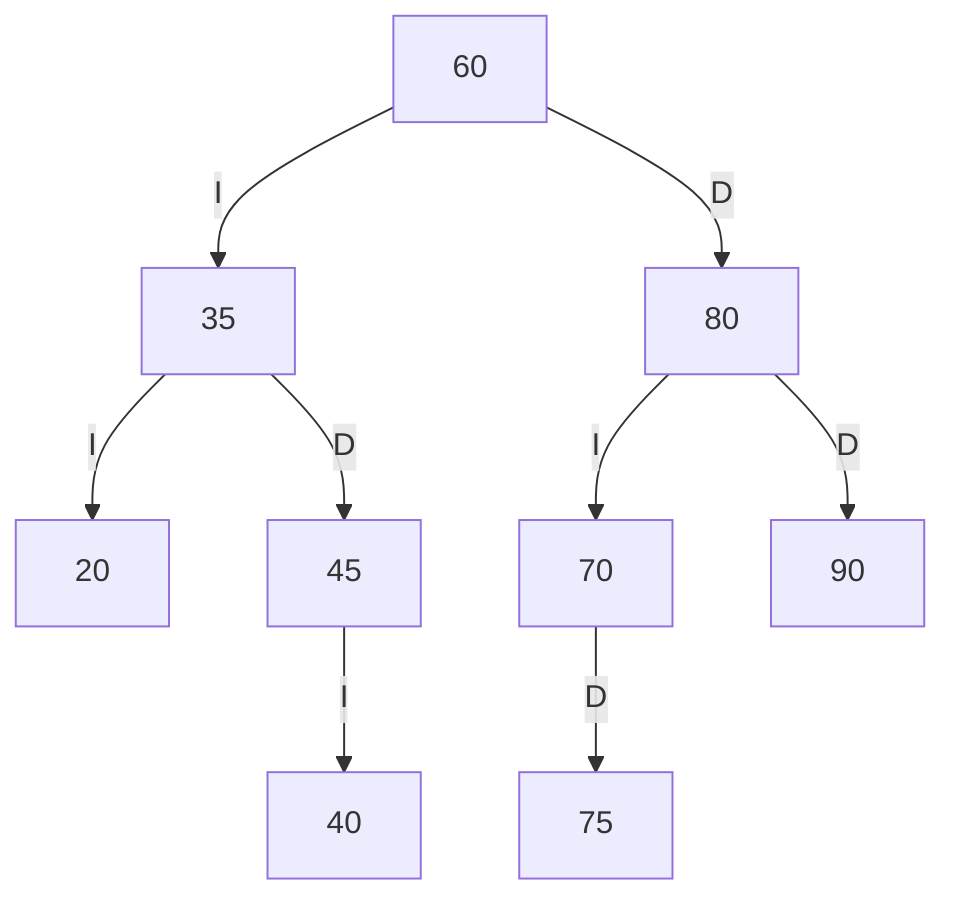
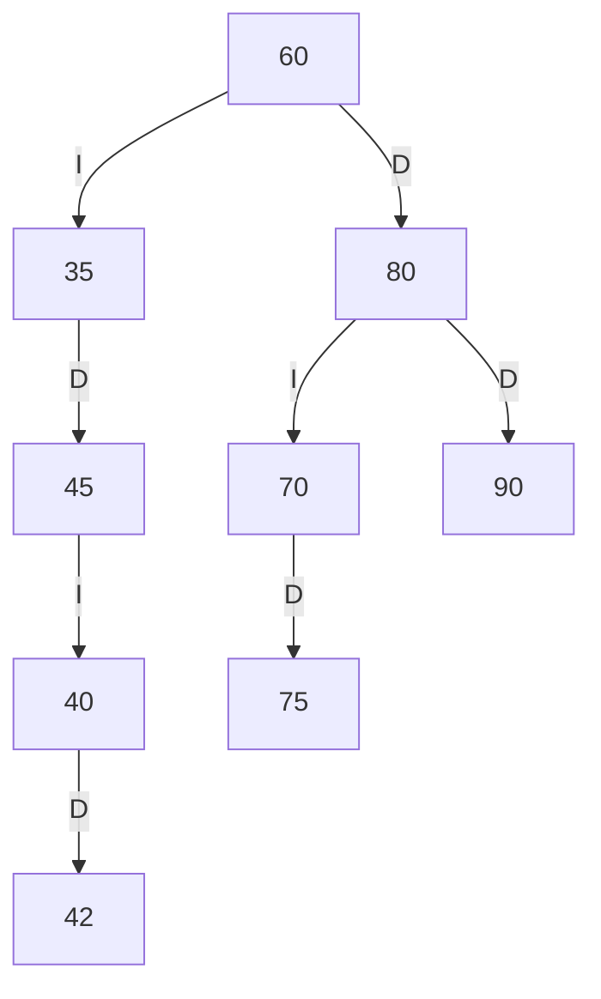
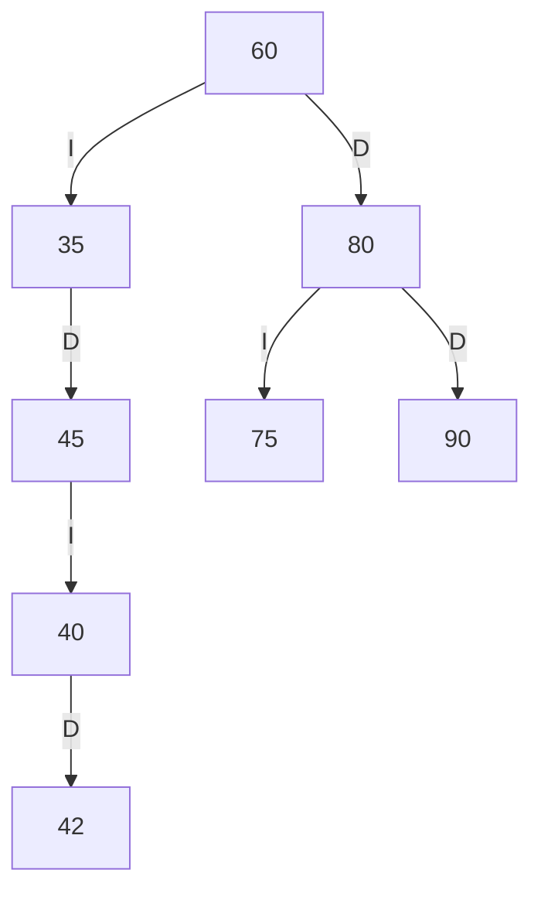
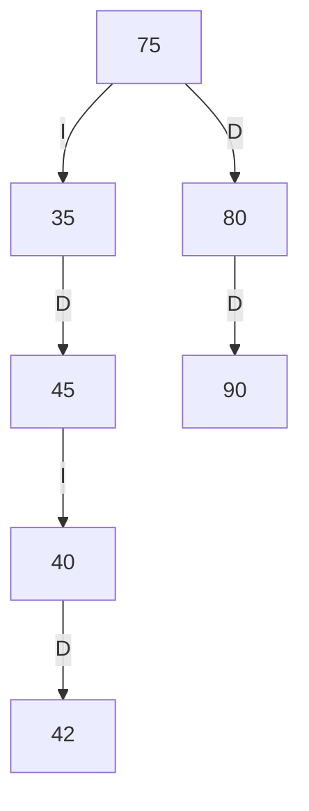

# Trazas manuales — Biblioteca FISEI

## 1. Códigos personales y árbol final

Completa esta sección localmente con los cuatro últimos dígitos de tu cédula;
no los publiques en este archivo ni los compartas en el chat.

1. Separa los dígitos como `abcd` y forma `ab`, `bc` y `cd` como enteros.
2. Si un resultado es cero, se repite o ya está en SW-E1 (20, 35, 40, 45, 60,
   70, 75, 80 o 90), súmale 1. Repite el ajuste hasta obtener tres códigos
   positivos, distintos entre sí y que no estén en el catálogo.
3. Anota los tres códigos aquí y luego insértalos, en ese orden, después de la
   secuencia inicial de SW-E1: `60, 35, 80, 20, 45, 70, 90, 40, 75`.

```text
Códigos personales (guardar solo en la copia privada): ____, ____ y ____.
Secuencia completa para construir el ABB: 60, 35, 80, 20, 45, 70, 90, 40, 75,
                                          ____, ____ y ____.
```

El diagrama, los recorridos y la traza de esta sección dependen de esos tres
códigos. Usa el menú de la aplicación o dibuja el ABB siguiendo las inserciones
y completa los espacios antes de preparar las capturas. El ejemplo verificable
con los nueve códigos iniciales está abajo.

## 2. ABB inicial de SW-E1

Cada arista indica si el hijo es izquierdo (`I`) o derecho (`D`).



## 3. Recorridos del ABB inicial

```text
Preorden: 60 35 20 45 40 80 70 75 90
Inorden:  20 35 40 45 60 70 75 80 90
Posorden: 20 40 45 35 75 70 90 80 60
```

### Traza completa de preorden

```text
entra 60
VISITA 60
  entra 35
  VISITA 35
    entra 20
    VISITA 20
      null -> regresa
      null -> regresa
    entra 45
    VISITA 45
      entra 40
      VISITA 40
        null -> regresa
        null -> regresa
      null -> regresa
  entra 80
  VISITA 80
    entra 70
    VISITA 70
      null -> regresa
      entra 75
      VISITA 75
        null -> regresa
        null -> regresa
    entra 90
    VISITA 90
      null -> regresa
      null -> regresa
Secuencia PREORDEN: 60 35 20 45 40 80 70 75 90
```

## 4. Retos de búsqueda y rango

El código `42` no está insertado en el ABB inicial. Al buscarlo se visitan:

```text
caminoBusqueda(42): [60, 35, 45, 40]
contarEnRango(40, 75): 5  (40, 45, 60, 70, 75)
```

## 5. Tres eliminaciones, en orden

Partiendo del ABB inicial, inserta primero el código `42`. A continuación,
elimina `20` (hoja), `70` (un hijo, su hijo derecho es `75`) y `60` (dos hijos;
se reemplaza por su sucesor inorden `75`).

Después de eliminar la hoja `20`:



Después de eliminar el nodo `70` (un hijo):



Después de eliminar `60` (dos hijos; sucesor `75`):



```text
Preorden final: 75 35 45 40 42 80 90
```

## 6. Comparación con la ejecución

| Punto | Resultado calculado a mano | Comparación |
| --- | --- | --- |
| Estructura inicial | 7 unidades, 4 hojas, altura 2, 13 libros | Coincide con `PruebasBiblioteca` |
| Recorridos iniciales de SW-E1 | Ver sección 3 | Coinciden con `PruebasBiblioteca` |
| Camino a 42 y rango 40–75 | `[60, 35, 45, 40]`; 5 libros | Coincide con `PruebasBiblioteca` |
| Eliminaciones 20, 70 y 60 tras insertar 42 | Preorden `75 35 45 40 42 80 90` | Coincide con `PruebasBiblioteca` |
| Tres códigos personales | Completar después de calcularlos privadamente | Pendiente de completar y comparar |
