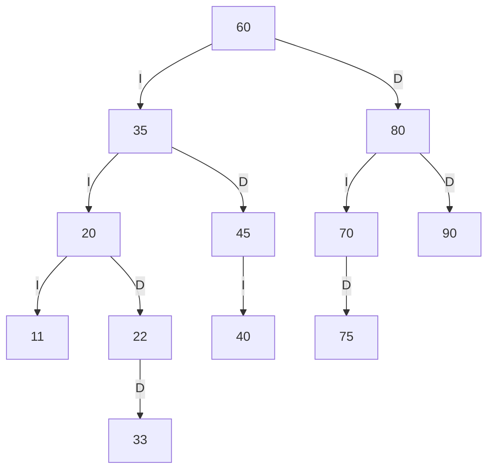
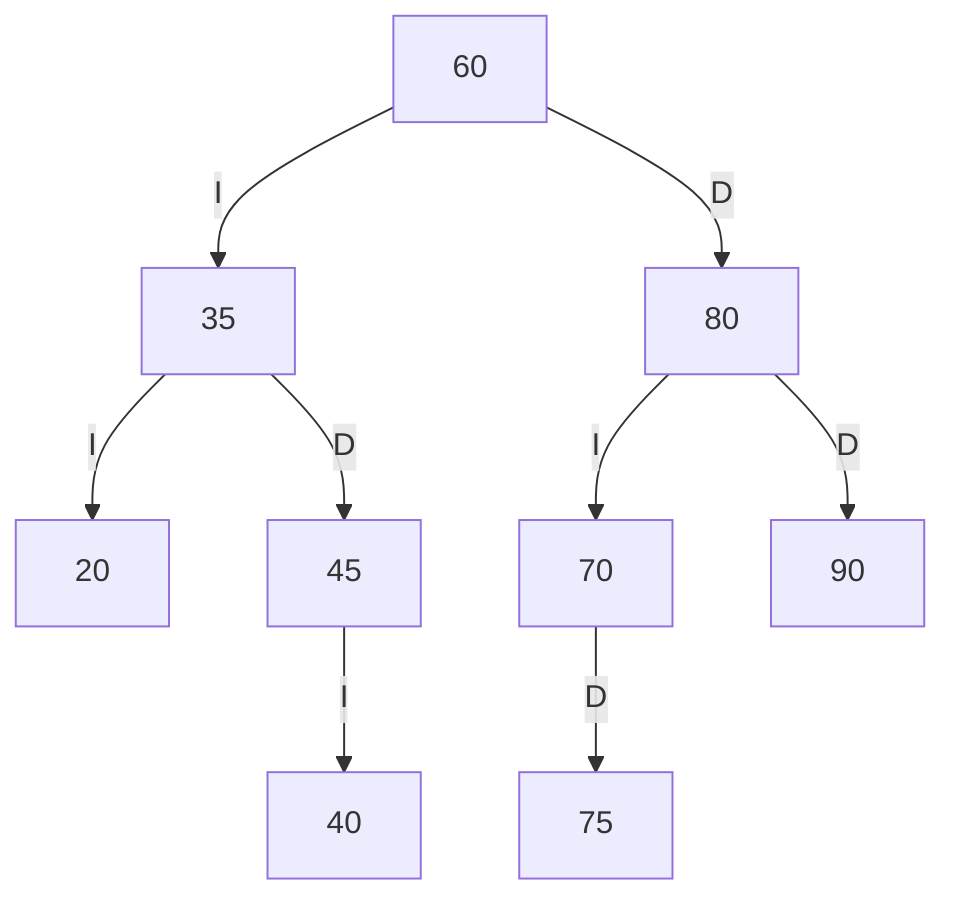
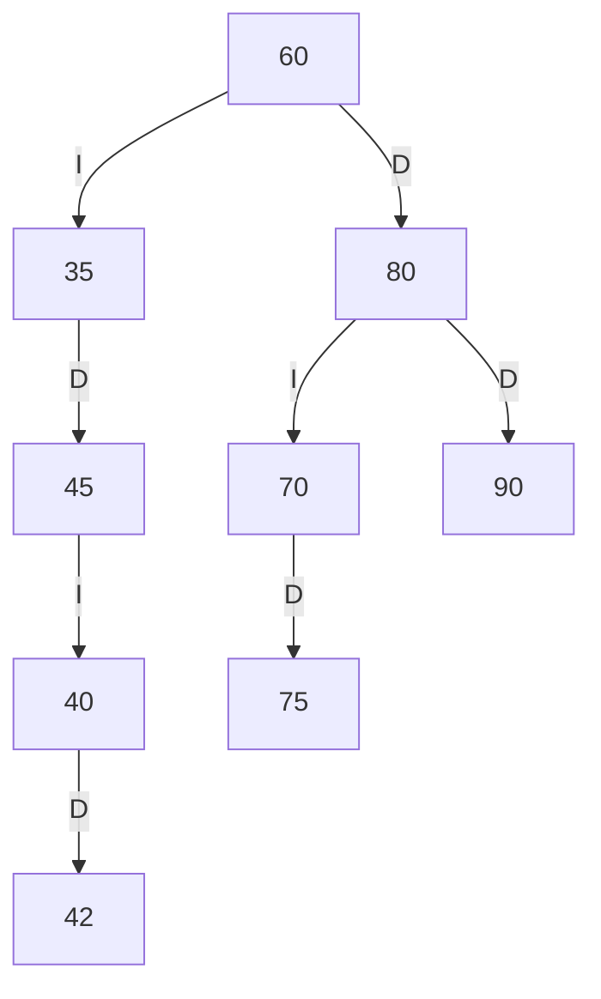
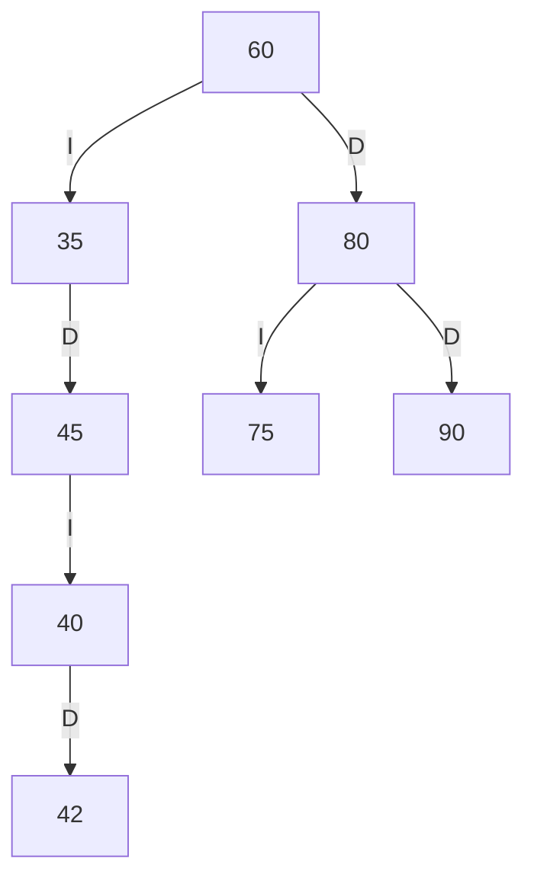
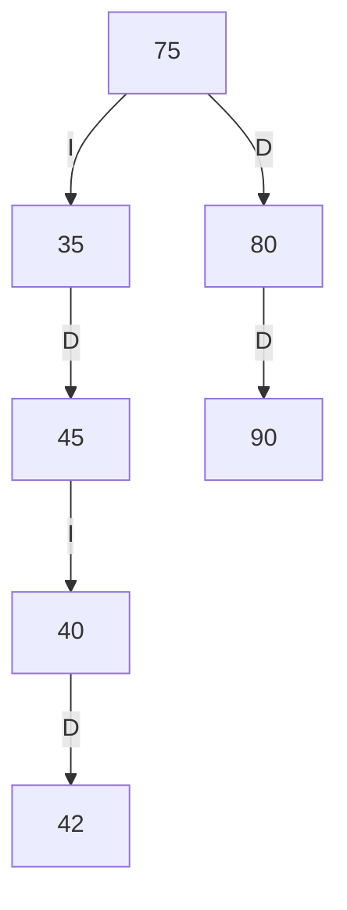

# Trazas manuales — Biblioteca FISEI

## 1. Códigos personales y árbol final

Los códigos de la consigna deben derivarse de los cuatro últimos dígitos de la
cédula. Como esos valores no se compartieron, se usan `11`, `22` y `33` solo
como **ejemplo demostrativo**: son positivos, distintos y no existen en SW-E1.
No son códigos personales ni se presentan como derivados de una cédula.

Para sustituir el ejemplo por los códigos correctos, calcula `ab`, `bc` y `cd`
de forma privada; si algún resultado es cero, se repite o ya existe en
SW-E1 (20, 35, 40, 45, 60, 70, 75, 80 o 90), súmale 1 hasta que los tres
valores sean positivos, distintos y no estén en el catálogo. Luego reemplaza
`11, 22, 33` por esos resultados en la secuencia.

```text
Códigos de ejemplo (no personales): 11, 22 y 33.
Secuencia demostrativa: 60, 35, 80, 20, 45, 70, 90, 40, 75, 11, 22, 33.
```

La aplicación permite reproducir exactamente esta secuencia con
`DatosPrueba.crearCatalogoSW_E1ConCodigos(11, 22, 33)`. Al entregar, reemplaza
los códigos y todos los resultados demostrativos por los personales calculados.

### ABB con los tres códigos demostrativos



Los recorridos del árbol demostrativo son:

```text
Preorden: 60 35 20 11 22 33 45 40 80 70 75 90
Inorden:  11 20 22 33 35 40 45 60 70 75 80 90
Posorden: 11 33 22 20 40 45 35 75 70 90 80 60
```

### Traza de preorden demostrativa

```text
entra 60
VISITA 60
  entra 35
  VISITA 35
    entra 20
    VISITA 20
      entra 11
      VISITA 11
        null -> regresa
        null -> regresa
      entra 22
      VISITA 22
        null -> regresa
        entra 33
        VISITA 33
          null -> regresa
          null -> regresa
    entra 45
    VISITA 45
      entra 40
      VISITA 40
        null -> regresa
        null -> regresa
      null -> regresa
  entra 80
  VISITA 80
    entra 70
    VISITA 70
      null -> regresa
      entra 75
      VISITA 75
        null -> regresa
        null -> regresa
    entra 90
    VISITA 90
      null -> regresa
      null -> regresa
Secuencia PREORDEN: 60 35 20 11 22 33 45 40 80 70 75 90
```

## 2. ABB inicial de SW-E1

Cada arista indica si el hijo es izquierdo (`I`) o derecho (`D`).



## 3. Recorridos del ABB inicial

```text
Preorden: 60 35 20 45 40 80 70 75 90
Inorden:  20 35 40 45 60 70 75 80 90
Posorden: 20 40 45 35 75 70 90 80 60
```

### Traza completa de preorden

```text
entra 60
VISITA 60
  entra 35
  VISITA 35
    entra 20
    VISITA 20
      null -> regresa
      null -> regresa
    entra 45
    VISITA 45
      entra 40
      VISITA 40
        null -> regresa
        null -> regresa
      null -> regresa
  entra 80
  VISITA 80
    entra 70
    VISITA 70
      null -> regresa
      entra 75
      VISITA 75
        null -> regresa
        null -> regresa
    entra 90
    VISITA 90
      null -> regresa
      null -> regresa
Secuencia PREORDEN: 60 35 20 45 40 80 70 75 90
```

## 4. Retos de búsqueda y rango

El código `42` no está insertado en el ABB inicial. Al buscarlo se visitan:

```text
caminoBusqueda(42): [60, 35, 45, 40]
contarEnRango(40, 75): 5  (40, 45, 60, 70, 75)
```

## 5. Tres eliminaciones, en orden

Partiendo del ABB inicial, inserta primero el código `42`. A continuación,
elimina `20` (hoja), `70` (un hijo, su hijo derecho es `75`) y `60` (dos hijos;
se reemplaza por su sucesor inorden `75`).

Después de eliminar la hoja `20`:



Después de eliminar el nodo `70` (un hijo):



Después de eliminar `60` (dos hijos; sucesor `75`):



```text
Preorden final: 75 35 45 40 42 80 90
```

## 6. Comparación con la ejecución

| Punto | Resultado calculado a mano | Comparación |
| --- | --- | --- |
| Biblioteca con solo la raíz | Altura 0; 1 hoja | Coincide con `biblioteca con solo la raíz` |
| Biblioteca inicial | 7 unidades, 4 hojas, altura 2, 13 libros | Coincide con `estructura inicial` |
| Niveles | BIB = 0; sw = 1; SW-E2 = 2; XYZ = -1 | Coincide con `niveles y búsqueda sin distinguir mayúsculas` |
| Insertar un estante directamente bajo BIB | `false` | Coincide con `reglas de inserción y códigos únicos` |
| Recorridos iniciales de SW-E1 | Ver sección 3 | Coinciden con `recorridos del estante SW-E1` |
| Insertar código duplicado | `false` | Coincide con `duplicado, camino y rango` |
| Camino a 42 y rango 40–75 | `[60, 35, 45, 40]`; 5 libros | Coincide con `duplicado, camino y rango` |
| Eliminaciones 20, 70 y 60 tras insertar 42 | Preorden `75 35 45 40 42 80 90` | Coincide con `eliminación de hoja, un hijo y dos hijos` |
| Búsqueda/modificación/eliminación inexistentes | `null / false / false` | Coincide con `operaciones sobre libro inexistente` |
| Crear libro inválido | `IllegalArgumentException` | Coincide con `validaciones de datos de libro` |
| Nieto fuera de los límites del ABB | `esABBValido()` devuelve `false` | Coincide con `ABB inválido por nieto mal ubicado` |
| Reconstruir desde preorden | Conserva el preorden inicial y es ABB válido | Coincide con `reconstrucción directa desde preorden` |
| Tres códigos demostrativos `11, 22, 33` | Secuencia, ABB y recorridos demostrativos en sección 1 | Coinciden con `inserción de tres códigos demostrativos`; no reemplaza los códigos personales |

La salida completa de los 13 casos se muestra en el README. Para la evidencia
solicitada, ejecuta `PruebasBiblioteca` en tu terminal y toma una captura real
de la salida en tu equipo.

La ejecución local guardada en [`docs/resultado-pruebas.txt`](docs/resultado-pruebas.txt)
confirma los casos generales. Todavía no sustituye las trazas, recorridos y
diagrama del ABB personalizado: esos resultados solo pueden completarse cuando
se agreguen los tres códigos personales calculados según la consigna.
